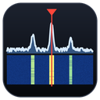

# TS-890S Desktop Front Panel

**Control your Kenwood TS-890S from your Windows PC or Mac. It has a TCI
server, a full logbook, a DX cluster and a set of shortwave decoders built
in.**

[](https://github.com/lmacc/Kenwood-TS-890-Client-TCI-Server-v2/releases/latest)


[](https://www.paypal.com/donate/?business=9XVP453VRC5GC&no_recurring=0&item_name=Free%2C+and+always+will+be.+If+it%27s+earned+a+place+in+your+shack%2C+a+coffee+keeps+it+growing.+73%2C+Leslie+EI5GJB&currency_code=EUR)

<br clear="left">

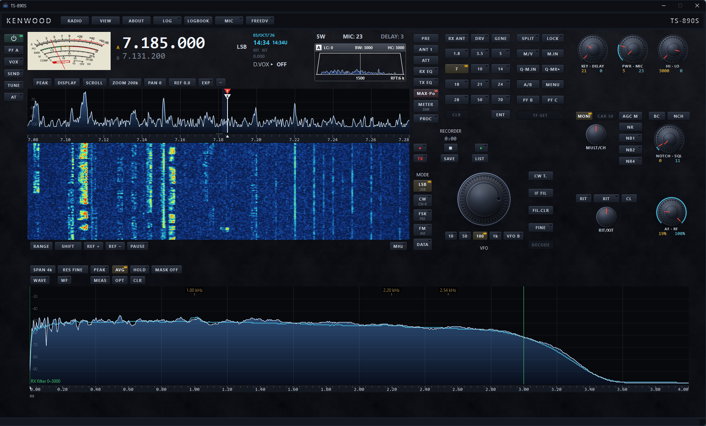

*The front panel as a new install opens it. Across the top: the analogue
S-meter, the frequency, the clock, RIT/XIT and D.VOX, then power, MIC and
DELAY over the filter scope. Below: the bandscope and waterfall, the
radio's own keys and knobs, and the audio scope along the bottom.*

The keys, knobs and meters look and work like the ones on the radio. You
can move, resize and hide the groups of controls, and save your own
layouts. CAT control and audio go over the radio's USB cable. The bandscope
comes over your network, because the USB serial link is too slow for a
smooth scope. Or connect over the network alone, and use the radio from
somewhere else.

> **Version 2.4.8 replaces every earlier release.** Run its installer and it
> removes the version you have and puts itself in its place: your settings,
> layouts and logbook are kept. Updates only go forward, so everyone is on
> the same version. If you use the Remote Relay at home, update that too
> (see [Remote operation](#remote-operation-experimental)).

**New in 2.4.8:** set the [remote receiver's filter](#remote-receivers-hear-yourself-from-far-away)
exactly, with its own low and high cut (or drag its edges on the waterfall),
wider presets, and a **REMOTE RX** key on the top row.

**In 2.4.7:** [every window fits your screen](#fits-your-screen), on a
13-inch laptop too: the logbook, the PSK map, Remote receivers, the About box
and the rest open smaller or with scroll bars, and the main window offers to
fit as soon as the screen or Windows' scaling changes.

**In 2.4.6:** [tune the remote receivers](#remote-receivers-hear-yourself-from-far-away)
on their own, up and down their bands, with their own frequency, steps,
mode and a list of the amateur and broadcast bands, as on a KiwiSDR's own
page; and smoother audio from them.

**In 2.4.5:** [band plans](#band-plans) for Ireland, the UK, the USA,
Canada, Australia and all three IARU regions on every HF band, with up to
four other countries' plans shown under your own; and
[remote receivers](#remote-receivers-hear-yourself-from-far-away): listen
on more than 900 KiwiSDRs and UberSDRs around the world, following your
radio, so you can hear and see your own signal as other people do. Also a
tidier RADIO menu, and working windows that no longer stay in front of the
panel.

## Contents

- [What it does](#what-it-does)
- [The logbook](#the-logbook) · [Logging a QSO](#logging-a-qso) ·
  [Contests](#contests) · [QSL services](#qsl-services-qrzcom-and-logbook-of-the-world) ·
  [Who is hearing me](#who-is-hearing-me-the-psk-map)
- [The DX cluster](#the-dx-cluster) ·
  [Calls to watch for](#calls-to-watch-for) · [Propagation](#propagation)
- [Remote receivers](#remote-receivers-hear-yourself-from-far-away) ·
  [Listening](#listening-broadcasts-bookmarks-and-logs) ·
  [Data decoders](#data-decoders)
- [Remote operation](#remote-operation-experimental) ·
  [Fits your screen](#fits-your-screen) · [The top of the screen](#the-top-of-the-screen)
- [Talk through the computer](#talk-through-the-computer) ·
  [FreeDV](#freedv-digital-voice) · [VST 3 plugins](#vst-3-plugins)
- [CW, RTTY and PSK31](#cw-rtty-and-psk31) · [Reading CW](#reading-cw) ·
  [Band plans](#band-plans) · [Log4OM over TCI](#log4om-over-tci)
- [Download and install](#download-and-install) ·
  [The user guide](#the-user-guide) · [Support](#support)

## What it does

**Operating**

- **The radio's front panel on your screen.** VFOs, band keys from 1.8 to
  70 MHz, modes, filters, split, TF-SET, RIT/XIT, AGC, NR, NB, notch, the
  meters and the radio's own menu. It all stays in step with the rig.
- **The top of the radio's screen.** Analogue or digital S-meter, the
  frequency display laid out as the radio's, filter scope, clock, RIT/XIT,
  D.VOX, power, MIC and DELAY.
- **Tuning to the hertz.** FINE gives 1 Hz steps, as on the radio, and the
  tuning knob follows the mouse smoothly.
- **Bandscope and waterfall** over your network. Click to tune, drag to
  tune, markers, drag the filter edges, and band plans for every HF band,
  your own country's and up to four others at once.
- **Audio scope.** See your receive and transmit audio, with peak and
  average traces, THD and S/N readings.
- **NR4 noise reduction** on the computer, on top of the radio's own NR.
- **CW, RTTY and PSK31.** Decode and send, with F1 to F8 macros. The CW
  decoder copies like a skimmer: it finds the station's tone, follows the
  speed, puts words right, colours callsigns and CW words, and names the
  stations it hears on the bandscope.
- **Talk through the computer.** Plug a headset into the PC and hold MIC
  or F12 to talk.
- **FreeDV digital voice.** RADE, 700D, 700E and 1600, receive and
  transmit, with FreeDV Reporter built in.
- **VST 3 plugins** on the microphone and on what you hear.
- **FT8 with WSJT-X.** WSJT-X decodes show up on the bandscope, coloured
  if the country is new to you.
- **Remote operation** (experimental), from another room or another
  country, with low data for a phone or hotspot and a readout of how good
  the link is.

**Logging and contests**

- **A full logbook** that can be your main log, kept in step with Log4OM
  or any other logger in both directions.
- **Statistics and a world map** of everything you have worked and
  confirmed.
- **Awards**: how far you have got with DXCC, WAZ, WAS, WAC, WPX, IOTA and
  the parks and summits, worked and confirmed.
- **A duplicate finder** that tidies up QSOs logged twice, and a **daily
  backup** of your logbook and settings.
- **Contests**: every contest ADIF knows, the exchange filled in from the
  call, serial numbers, dupes, a running tally, Cabrillo, and a contest
  calendar.
- **QRZ.com and Logbook of the World**: look up the station, send your
  QSOs, and bring the confirmations back.

**On the air**

- **Who is hearing me**: everyone who has reported your signal to PSK
  Reporter, on a map.
- **DX cluster** from Spothole, the telnet clusters and the Reverse Beacon
  Network's skimmers, with new countries picked out and spots on the
  bandscope.
- **Calls to watch for**: be told the moment a friend, a needed station or
  a DXpedition is spotted, decoded in FT8 or heard in CW.
- **Propagation**: space weather, HF and VHF conditions, live ionosondes
  and tropospheric ducting.

**Listening**

- **Remote receivers**: listen on KiwiSDRs and UberSDRs around the world,
  tuned with your radio, to hear your own signal as they hear it, with
  their S-meter and waterfall.
- **Broadcast schedule** for the whole world, with distances and bearings.
- **Bookmarks with a scanner**, a **listening log** with reception reports,
  **signal history** and **recordings at set times**.
- **Data decoders**: maritime DSC, ALE, aircraft HFDL with a live map,
  SELCAL, PACTOR (including Winlink email), the military modems, a signal
  identifier, NAVTEX and weather fax.

**Everything else**

- **TCI server.** Log4OM, WSJT-X, MSHV and other programs can follow the
  radio over TCI. The panel shows which ones are connected.
- **CAT sharing (Windows only).** Share the radio's CAT port with another
  program, such as DXLab, through a virtual serial port.
- **Fits your screen**, from a big monitor down to a 13-inch laptop.
- **Transmit safety.** If the app ever stops responding while you are
  transmitting, the radio is sent back to receive.
- **Tells you when there's a new version**, once a day, with the download
  one click away in ABOUT, and keeps the CW decoder's callsign list up to
  date. You can switch each off.
- **Recorder**, **keyboard shortcuts** for every key, and a full
  [user guide](#the-user-guide).

| | |
|---|---|
| 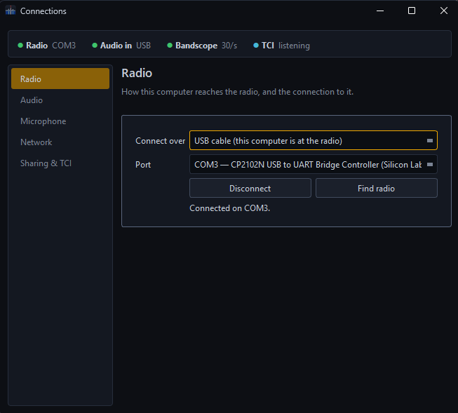 | 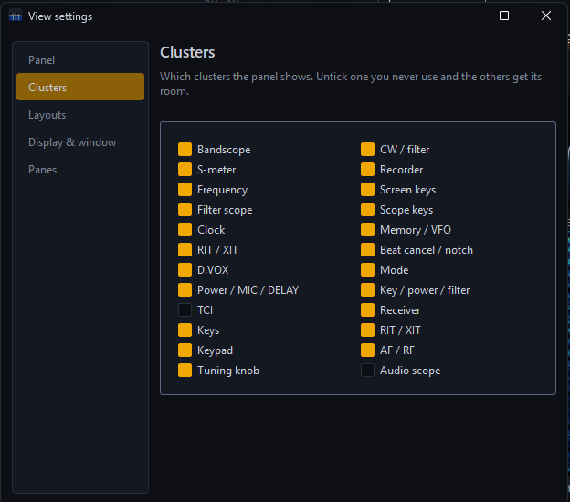 |
| All the setup in one window: a lamp for each link along the top, and pages for the radio, audio, microphone, network, and sharing and TCI. | View settings: the panel, its clusters, your layouts, the display size and the panes. |
| 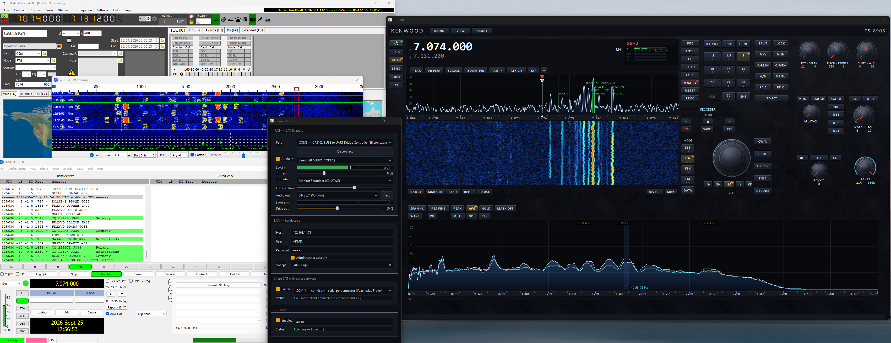 | 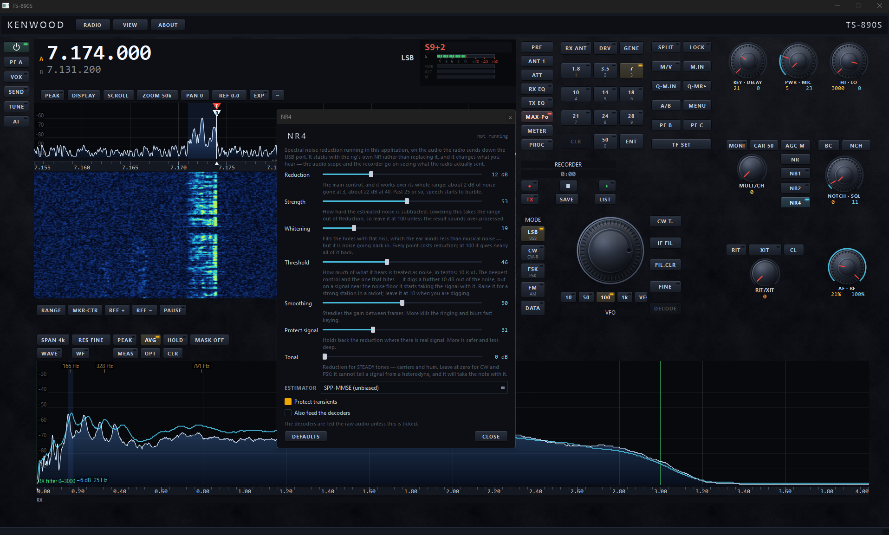 |
| Log4OM and WSJT-X following the radio. | NR4 noise reduction, with every setting explained. |
| 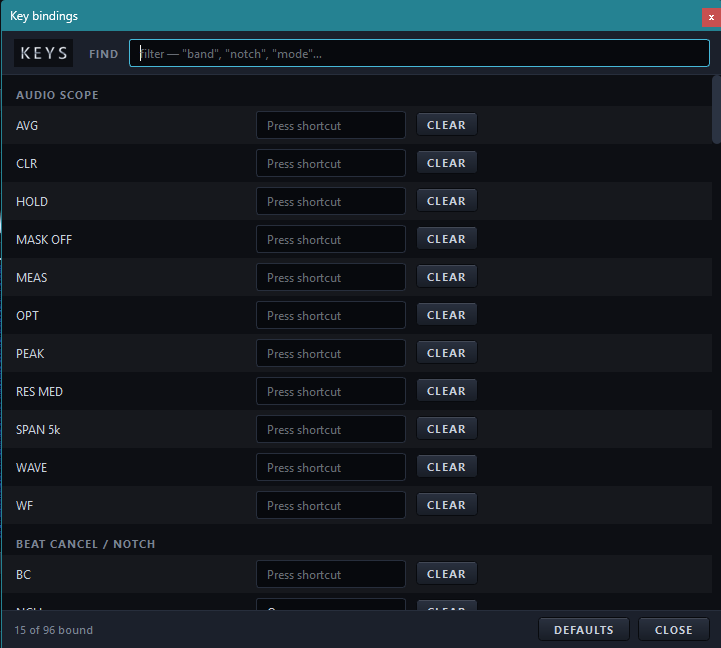 | |
| Put any key on the keyboard. | |

## The logbook

**LOGBOOK**, on the bar across the top, opens a full logbook. It can be
your main log: it keeps every ADIF field a QSO carries, works out each
station's country, zones and continent, and sends your QSOs to QRZ.com and
Logbook of the World. It stays in step with your logging program both
ways, so you can carry on using Log4OM, or any other logger, beside it.

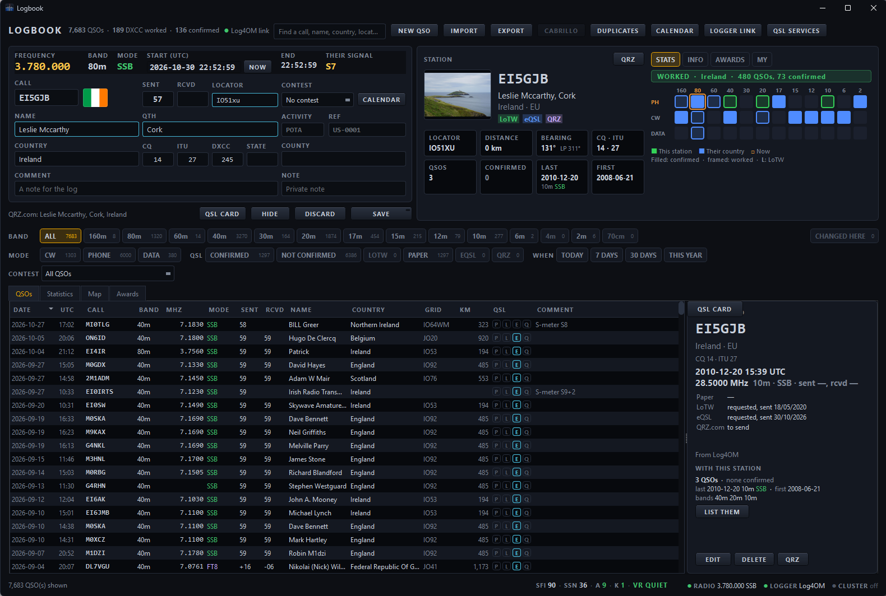

*7,682 QSOs read in from Log4OM: 189 DXCC entities worked and 136
confirmed. Each filter key along the top shows how many QSOs it holds. The
card on the right shows the selected QSO in full, where it stands with each
QSL service, and every earlier QSO with that station.*

- **Find any QSO** with the filters: band (Ctrl+click for several), mode,
  QSL status and service, today, the last 7 or 30 days or this year, one
  contest, or a search for a call, name, country or locator.
- **The QSL column** shows four letters, P (paper), L (LoTW), E (eQSL) and
  Q (QRZ.com): dim for nothing yet, outlined for sent, filled for
  confirmed.
- **EDIT** opens every field of a QSO, including the QSL status for each
  service and any other ADIF field it carries. **IMPORT** and **EXPORT**
  read and write ADIF; QSOs already in the log are never added twice.
- **LOGGER LINK** sends each QSO you log to your logger, and reads your
  logger's log back: new QSOs, and changes such as a confirmation or a name
  filled in, come into this logbook. Log4OM needs nothing setting up. Your
  logger's own database is only ever read, never written.

| | |
|---|---|
| 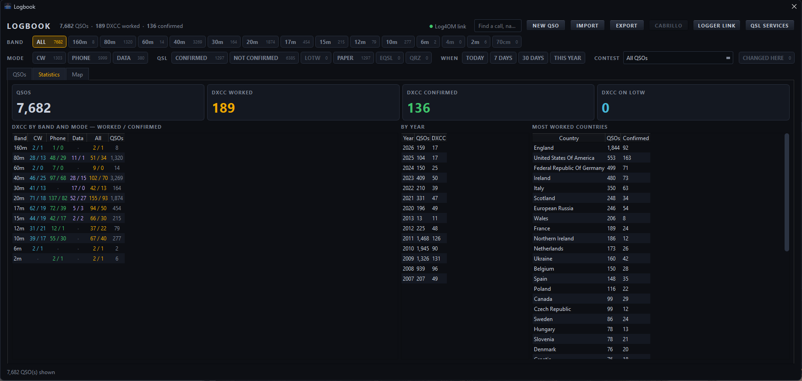 | 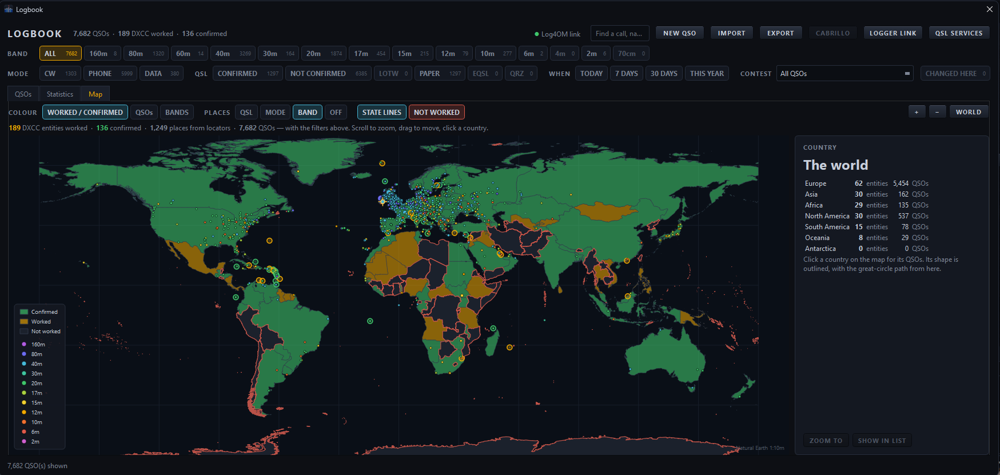 |
| **Statistics**: DXCC worked and confirmed on each band in CW, phone and data, your QSOs year by year, and the countries you have worked most. They follow the filters, so you can see just one band, mode or year. | **The map**: countries shaded green for confirmed, amber for worked, and outlined in red if you still need them. Every place you have worked is a dot, coloured by band, mode or QSL. Click a country to see its QSOs, with the great-circle path from you. |

The map is drawn from Natural Earth at 1:10 million, so coasts and small
islands are shown in detail, and it zooms in far enough to show state and
county lines.

**The Awards tab** shows how far you have got with DXCC, WAZ (the 40 CQ
zones), WAS (the 50 US states), WAC (the six continents), WPX, IOTA, and the
POTA, SOTA and WWFF references in your log. Each is counted as worked and
confirmed. The zones, states and continents are drawn as grids, green when
confirmed, amber when worked and dark when still needed. The islands and
parks are listed underneath. Like everything else in the Logbook, the awards
follow the filters, so 20m and CW gives you WAS on 20 metres CW. If some of
your US QSOs have no state, it tells you how many, and EDIT lets you add it.

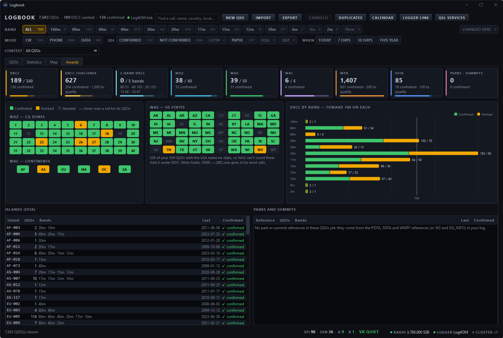

*The Awards tab for 7,685 QSOs: 189 DXCC, 38 of the 40 CQ zones, 39 of the
50 states and all six continents, with the islands listed underneath.
Green is confirmed, amber worked, dark still needed.*

**DUPLICATES** finds QSOs that are in the log more than once: the same
call, band and kind of mode within ten minutes. Each QSO logged more than
once is shown as a group, with the copy to keep marked **KEEP**: the one
with the most confirmations, or else the most details filled in. Each spare
copy says where to delete it:

- **delete**: a copy made in this app or imported from a file. These are
  already selected, so **DELETE SELECTED** removes them, after one more
  question. One copy of each QSO always stays.
- **delete in Log4OM** (or whichever logger you use): a duplicate inside
  your logger's own log. Delete it there, and it disappears from here by
  itself. It can't be deleted here, because the logger link would bring it
  straight back.

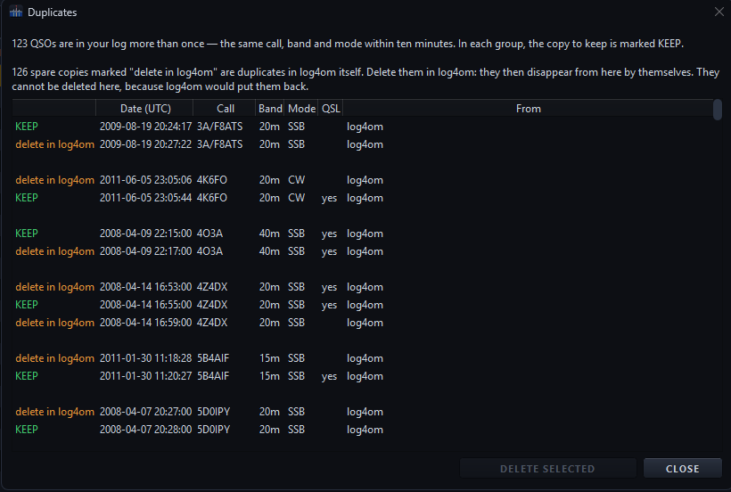

*A log kept in Log4OM. Every spare copy here is a duplicate inside Log4OM
itself, so each is marked "delete in log4om" and there is nothing to delete
in this window.*

- **A backup every day.** Your logbook and settings are copied once a day to
  a *backups* folder beside them, and the newest ten are kept. **RADIO → Back
  up settings and logbook now** makes one straight away, and **RADIO → Open
  the backups folder** shows where they are. The user guide explains how to
  restore one.

## Logging a QSO

Press **Ctrl+L** anywhere in the app, or **NEW QSO** in the Logbook, and
the Log QSO window opens with the frequency, band, mode, start time and
their signal already filled in. Press Ctrl+L or Enter again to save it.

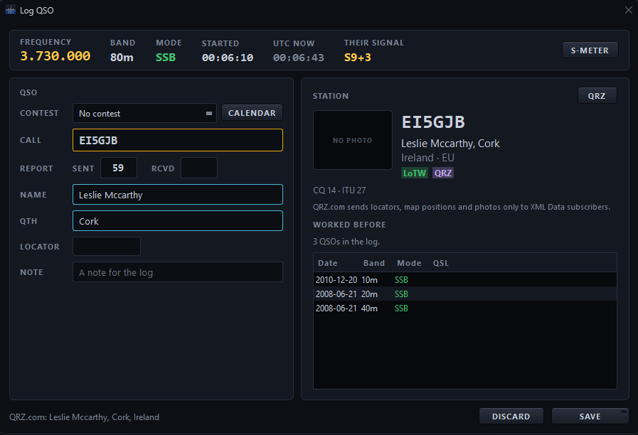

*A QSO on 80 m SSB. The name and QTH came from QRZ.com and are outlined
to show it. The Station card gives the country, zones and badges, and
lists the earlier QSOs with this station.*

- **The Station card** fills in as you type the call: their name, QTH and
  country, a photo from QRZ.com, how far away they are and the bearing,
  their zones, and badges for a **new country**, a **new band**, a **first
  QSO**, and whether they use LoTW or eQSL. The **QRZ** key opens their
  page in your browser.
- **The distance says where it came from**: their exact position on
  QRZ.com's map, their locator, an earlier QSO in your log, or one you
  typed. A four-character locator is a large square, and the card says how
  far out that can be.
- **In SSB** your report is made from the S-meter: S7 gives 57. In CW,
  RTTY and PSK31, the call and report come from the decode pane.
- **DISCARD** drops the QSO and starts a fresh one, so the window stays
  ready for the next station.
- Every QSO also gets the station's country, DXCC number, zones, continent
  and WPX prefix, your power, and their S-meter reading.

## Contests

Choose a contest in the Log QSO window and it changes to suit: the
contest's own exchange, serial numbers, a warning for dupes, and a form
that stays open for the next QSO each time you save. Every contest that
ADIF has a name for is in the list, about 250 of them, and 76 of the
best-known have their exchange built in.

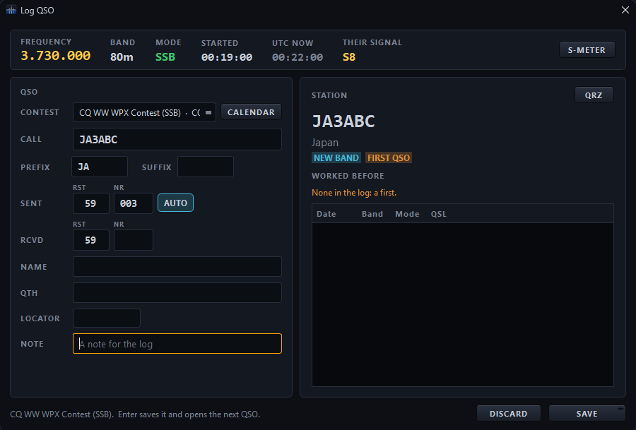

*A QSO in the CQ WW WPX Contest. The exchange both ways is RST and a
serial number, and AUTO has given this QSO 003. JA3ABC is a new band and a
first QSO; a station already worked in the contest would be marked DUPE.*

- **Filled in from the call**: the WPX prefix, the suffix (/P, /M, /MM…),
  and their CQ or ITU zone. Your own zone starts as the one your call is
  in, and what you send is remembered for each contest.
- **Serial numbers** count up by themselves with **AUTO**, or you type
  them.
- **The time is stamped** the moment you save, and **Enter** saves the QSO
  and opens the next one straight away.
- **A running tally** under the exchange shows the contest so far: QSOs,
  bands, countries, zones and prefixes, and your rate over the last hour
  and the last ten minutes. It counts but doesn't score, because every
  contest scores in its own way.
- **No QRZ.com lookups** while you contest: no waiting, and your own log is
  still checked for dupes.

| | |
|---|---|
| 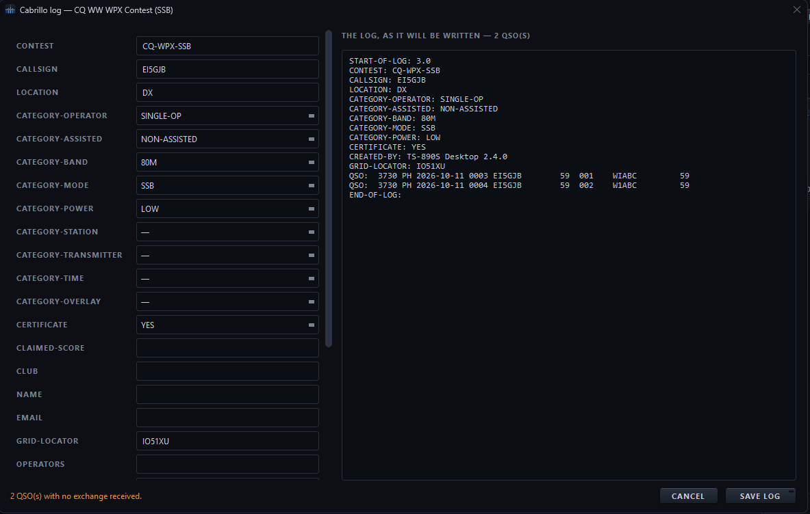 | 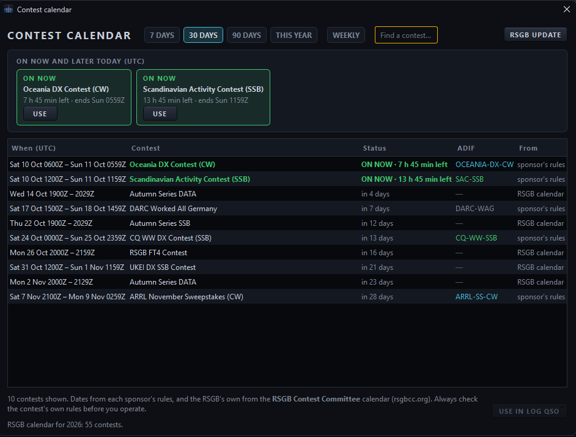 |
| **Cabrillo**: choose the contest in the Logbook and press CABRILLO. The header categories offer only what the Cabrillo standard allows, your details are remembered, and the log is shown exactly as it will be written, with a warning for anything missing. A contest's log can also be exported as ADIF. | **The contest calendar**: what is on now, later today and coming up, with the time left. USE sets the Log QSO window up for it, and today's contests are at the top of the contest list. Dates come from each sponsor's rules and from the RSGB Contest Committee's own calendar. |

## QSL services: QRZ.com and Logbook of the World

**QSL SERVICES**, in the Logbook, connects the log to QRZ.com and to the
ARRL's Logbook of the World.

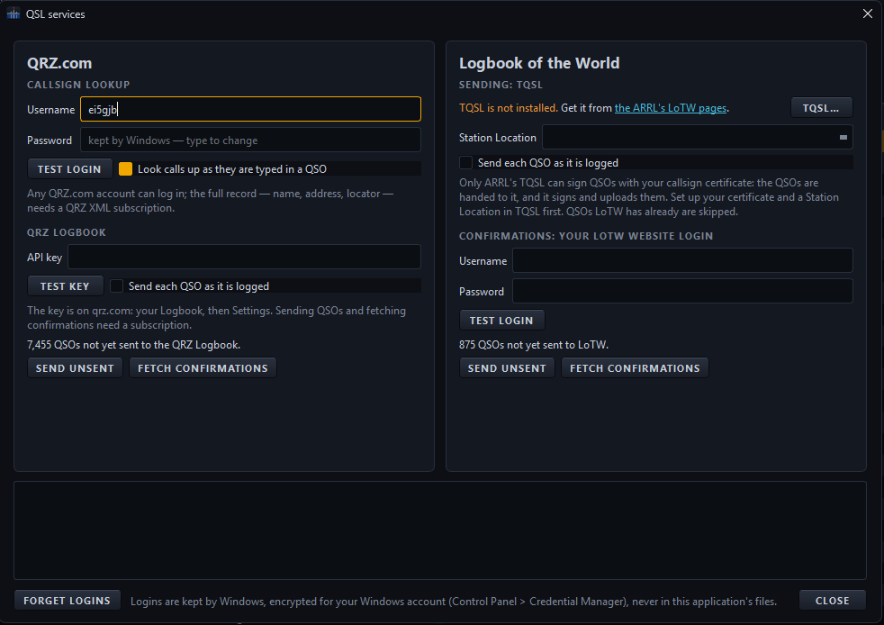

*QRZ.com on the left, Logbook of the World on the right, each with the
number of QSOs not yet sent.*

- **QRZ.com callsign lookup** fills in the Log QSO window as you type a
  call. Any account can log in; the full record and photo need a QRZ XML
  subscription.
- **QRZ Logbook**: send all your unsent QSOs, or each one as you log it,
  and fetch the confirmations.
- **Logbook of the World**: QSOs are handed to the ARRL's own TQSL, which
  signs and uploads them with your certificate. New confirmations are
  fetched by themselves every six hours.
- **Your logins are kept safe** by Windows' Credential Manager, or in the
  Keychain on a Mac, never in the app's own files.
- **TQSL** is found by itself in its usual place on Windows and on a Mac.

## Who is hearing me: the PSK map

**PSK MAP**, on the bar across the top, shows every station that has
reported hearing you on PSK Reporter: the question every operator asks
after calling CQ on FT8.

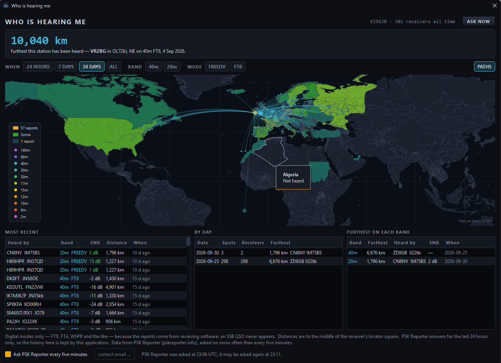

*Thirty days of reports. The furthest is across the top: VR2BG in Hong
Kong, 10,040 km away on 40 m FT8. Countries are shaded by how many reports
came from them, each receiver is a dot coloured by band, and PATHS draws
the great-circle path to each.*

- The furthest you have been heard, the most recent reports, the reports
  for each day, and the furthest on each band.
- Narrow it to the last 24 hours, 7 or 30 days, or all time, and to one
  band or mode.
- **The app keeps the history.** PSK Reporter only answers for the last 24
  hours, so the map keeps everything it has fetched. It asks no more often
  than every five minutes, as PSK Reporter asks.
- Digital modes only (FT8, FT4, WSPR and the like), because the reports
  come from receiving software.

## The DX cluster

**RADIO → DX cluster** shows who is on the air, where, and in what mode.
Double-click a spot to tune to it.

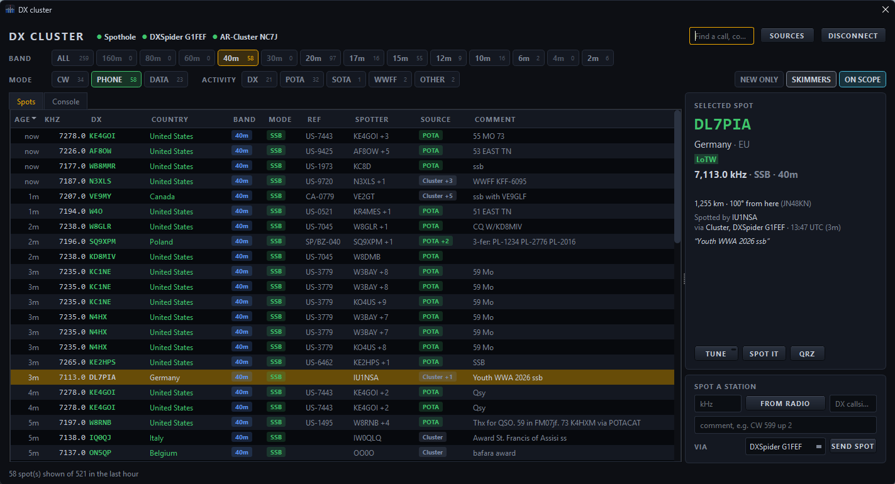

*40 m phone spots from Spothole and two telnet nodes. The selected spot
shows the distance and bearing, who spotted it and when, with TUNE, SPOT IT
and QRZ. Under it is the box for sending a spot of your own.*

- **Spots from Spothole**, which gathers the DX cluster network and the
  POTA, SOTA and WWFF programmes, and from **telnet cluster nodes**, as
  many as you like. A node on **standby** takes over by itself if Spothole
  can't be reached.
- **The Reverse Beacon Network**, straight from its own server: receivers
  around the world, called skimmers, that decode CW and RTTY and report
  every station they hear calling. **Skimmers in** keeps only the skimmers
  on your continent (to start with), in your country, or anywhere, so the
  stations named are ones you can probably hear.
- **Filters** for band, mode (CW, phone, data), activity (DX, POTA, SOTA,
  WWFF and others), **new countries only**, skimmers, and a search.
- **New ones stand out**: a country you have never worked is amber, and one
  you have worked but not on this band is cyan, as on the bandscope.
- **ON SCOPE** names the last half hour's spots on the bandscope. Turn on
  **SKIMMERS** as well, and the bandscope fills with the stations the
  skimmers hear calling right now.
- The same station spotted again stays on one row, with a count.
- **Send a spot** of your own through a telnet node, after a confirmation.
  **FROM RADIO** fills in the frequency.

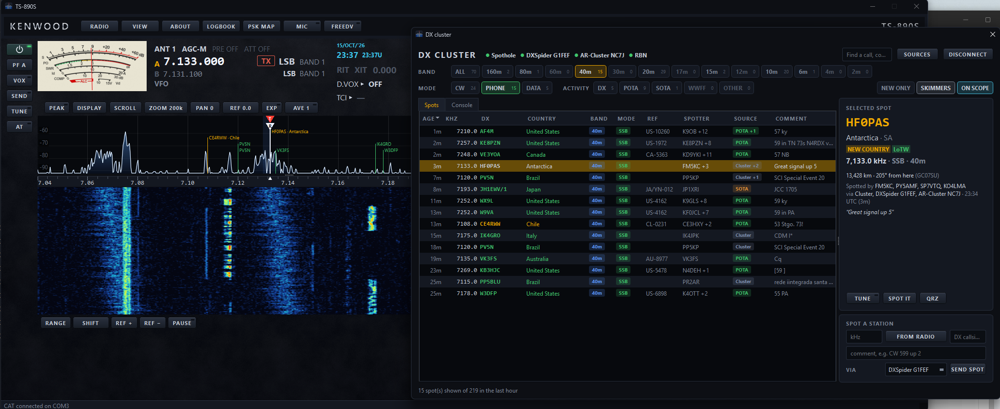

*40 m with ON SCOPE and SKIMMERS lit: each spotted station is named on the
bandscope above its signal, following the window's filters. HF0PAS in
Antarctica is a new country, so it is amber on the bandscope as well as in
the list.*

## Calls to watch for

To be told when a particular station turns up (a friend, a station you
need, a DXpedition), type its call under **Calls to watch for** in **RADIO →
Alerts**. Put spaces between calls. A **\*** stands for any letters, so
*VP8\** is every call starting VP8, and a call also matches with /P, /M or
a prefix added. You're told the moment a watched call is:

- spotted on the DX cluster, or heard by a Reverse Beacon Network skimmer;
- decoded in FT8;
- heard by the CW decoder giving its call.

The alert goes in the status bar, with a sound and a small window if you
want them. For a cluster spot, the window has a **Tune** key that takes the
radio straight there. Each call is alerted once per band in half an hour,
so a busy station doesn't keep interrupting you.

## Propagation

**RADIO → Propagation** shows what the sun, the ionosphere and the weather
are doing, and what that means for the bands.

| | |
|---|---|
| 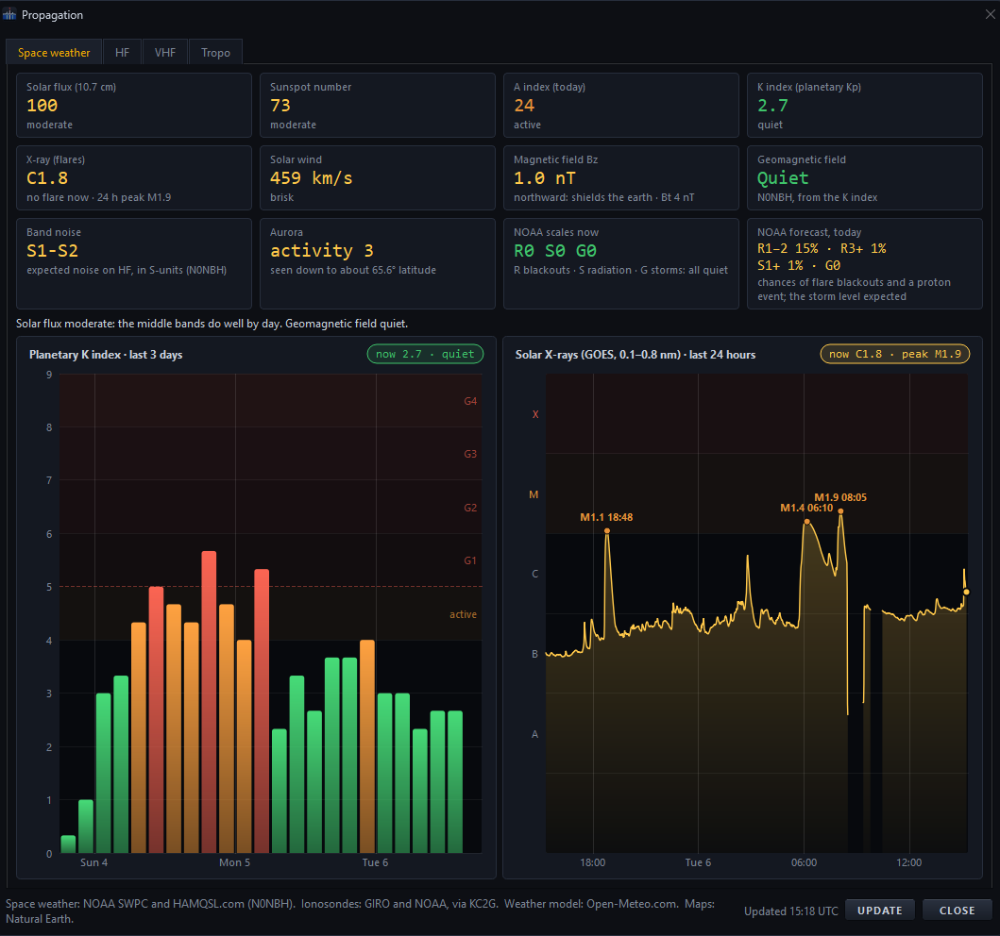 | 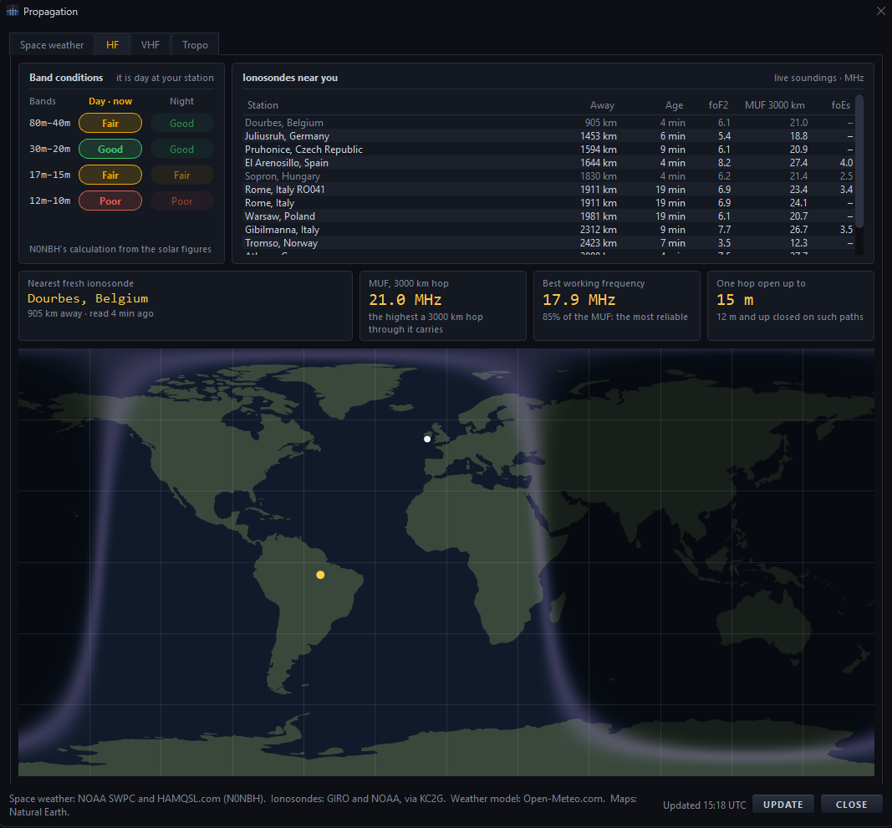 |
| **Space weather**: solar flux, sunspots, the A and K indices, flares, the solar wind, band noise, aurora and NOAA's scales, each with a few words on what it means, and charts of the K index and X-rays. | **HF**: band conditions by day and night, the live ionosondes nearest you, the highest frequency a 3,000 km hop will carry and the best one to use, and the greyline map. |
| 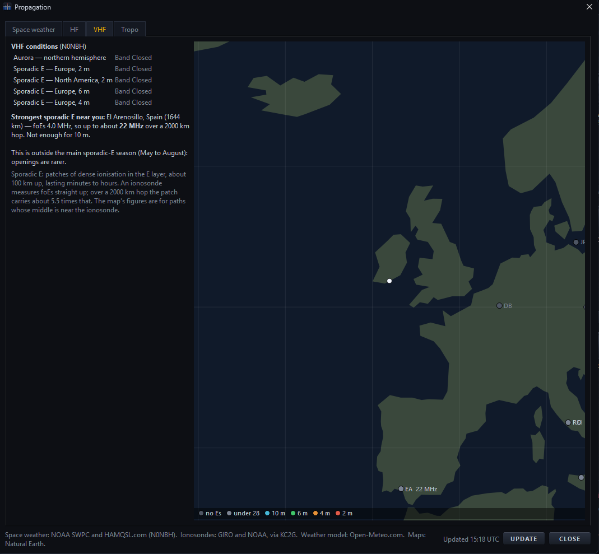 | 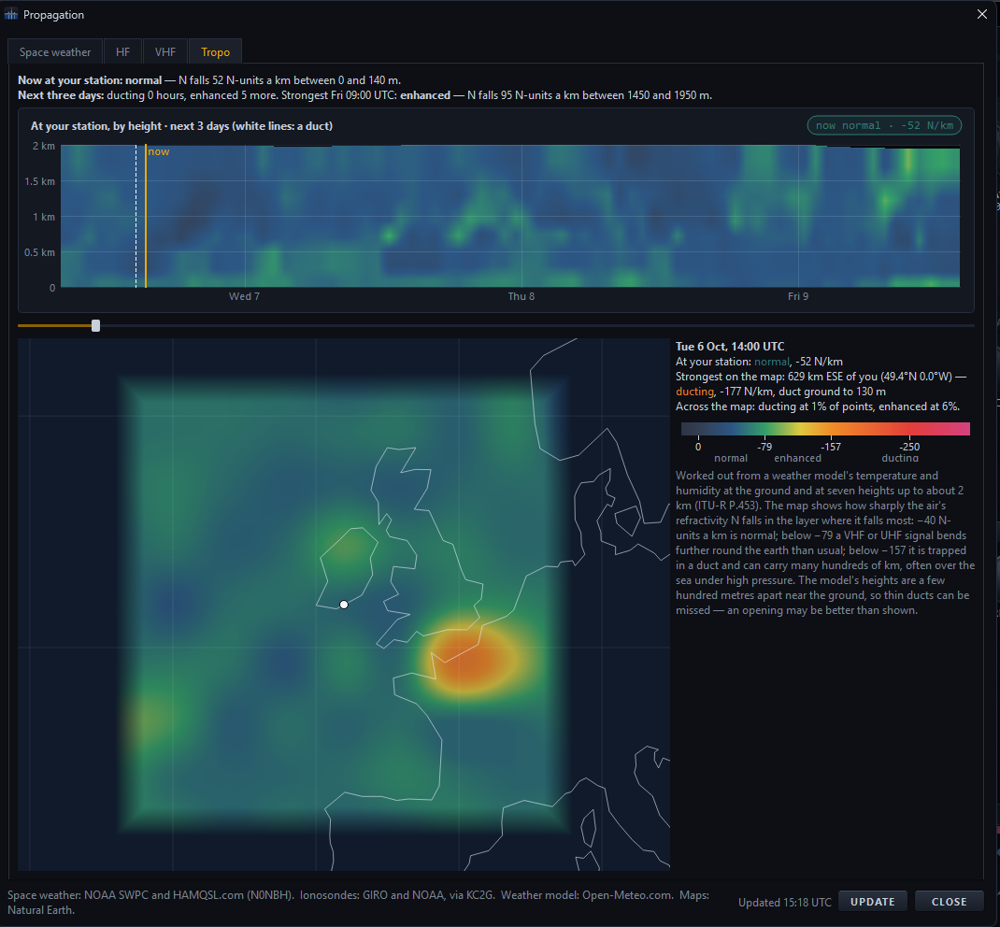 |
| **VHF**: aurora and sporadic E, the strongest sporadic E near you and the bands it would open, with the ionosondes on a map. | **Tropo**: ducting for the next three days at your station and on a map around you, worked out from a weather model to the ITU's method. |

## Remote receivers: hear yourself from far away

**RADIO → Remote receivers**, or the **REMOTE RX** key on the top row (lit
while you're listening), lists more than 900 online receivers around
the world: KiwiSDRs and UberSDRs that their owners share for anyone to
listen to. Choose one and its audio plays through the same speakers as your
radio.

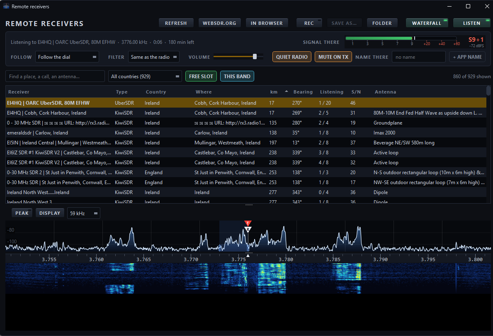

*Listening to an UberSDR in Cobh on 40 m. At the top: who and where, the
minutes left, the receiver's own S-meter and how it is tuned and heard.
Below the list, the receiver's waterfall with your R and T markers.*

- **Hear yourself.** With **Follow where I transmit**, the receiver stays on
  your transmit frequency, split and XIT included. Key up and, a second or
  two later, you hear your own signal as that part of the world hears it,
  and see it rise on the **SIGNAL THERE** meter. **Follow the dial** listens
  where your radio listens, to compare.
- **Or tune it on its own.** **Tune it here** lets go of your radio: type a
  frequency, step up and down from 10 Hz to 10 kHz, choose LSB, USB, CW, AM
  or FM, or pick a band from the list, the amateur bands from 160 m to 10 m
  and the broadcast bands from LW and MW up to 11 m. Choosing a band widens
  the waterfall to show all of it. On the waterfall a click, the mouse wheel
  or a drag tunes the receiver.
- **Find the right one.** Nearest first, with each receiver's country,
  distance and direction, how many are listening, its signal-to-noise and
  its antenna. Pick a country, show only receivers with a **FREE SLOT** or
  that cover **THIS BAND**, or search for a place, a callsign or an antenna.
- **Its own waterfall**, drawn like your radio's bandscope, from 30 MHz
  wide down to 1.8 kHz. Click it to tune your radio there, or the receiver
  alone with Tune it here.
- **Smooth audio.** A short reserve and its own playing thread ride out the
  bursts and gaps of audio over the internet.
- **Filter** copies your radio's own filter, or choose a width (up to 5.7 kHz
  in SSB, 12 kHz in AM), or **Custom** to set the **LOW** and **HIGH** cut
  yourself, in hertz. You can also drag the edges of the shaded passband on
  the receiver's waterfall. SSB can't go wider than about 5.9 kHz on these
  receivers: their SSB audio is sampled at 12 kHz.
- **QUIET RADIO** silences your own radio while you listen.
- **REC** records what the receiver plays to a WAV file.
- **A good guest.** The app only ever uses one listener slot and gives it
  back the moment you stop. You choose the name the owner sees: your
  callsign, any name, or none. UberSDRs set a time limit, and the app counts
  down the minutes left. **IN BROWSER** hands the receiver over to its own
  web page.

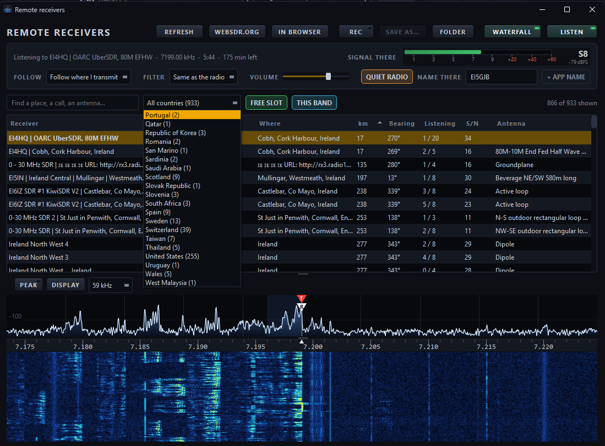

*The country list: every country with a receiver, and how many each has.
The country comes from where the receiver is, however its owner spelt it.*

## Listening: broadcasts, bookmarks and logs

For listening as much as for operating:

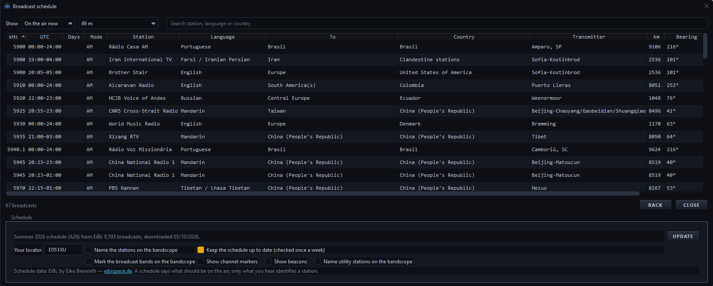

*The broadcast schedule, showing what is on the air now in the 49 m band,
with the distance and bearing to each transmitter.*

- **Broadcast schedule**: the world's shortwave broadcasts from EiBi, kept
  up to date by itself. Show what is on now or the whole season, by band
  or around the radio's frequency, and search by station, language or
  country. Double-click to tune, or right-click to tune with the carrier
  at zero beat, bookmark it, or record it once or every day. It can name
  the stations, mark the broadcast bands and show beacons on the bandscope.
- **Bookmarks and scanning**: keep frequencies of your own, with the mode
  and decoder settings. **SCAN** steps round the ones you tick and stops on
  any that is on the air.
- **Listening log**: FROM RADIO fills in the time, frequency, station and
  S-meter; you add the rest of the SINPO. **REPORT** puts a reception
  report on the clipboard, ready to email the station.
- **Signal history**: the S-meter over the last 15 minutes to 24 hours, to
  watch a band open and close. Save it as a spreadsheet file.
- **Recording schedule**: record a frequency at a set time, once or every
  day.
- **Back** (Alt+Left) returns the radio to where it was before the last
  jump.

## Data decoders

**RADIO → Data decoders** reads the data signals of the shortwave utility
stations: ships, aircraft, military and government stations, and
mailboxes. Choose the mode, tune to one of its channels, and press
**DECODE**.

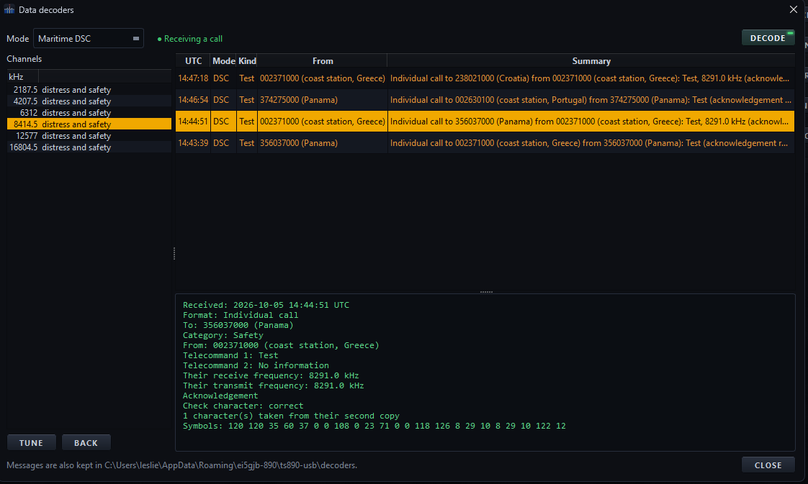

*Maritime DSC on 8414.5 kHz: the channels on the left, the calls received
on the right, and the selected call in full underneath.*

| Mode | What it reads |
|---|---|
| **Maritime DSC** | Ships and coast stations calling each other, distress alerts and their acknowledgements. |
| **ALE** | The warbling bursts of military, government and amateur stations sounding and calling. |
| **Aircraft HFDL** | Airliners over the oceans and their ground stations: messages, position reports and logons, with a live map. |
| **SELCAL** | The two-tone calls that raise one aircraft on the HF voice channels, with a code book of your own notes. |
| **PACTOR** | Mailboxes and ships' email: PACTOR-I read in full, Winlink email included, and PACTOR-II, III and 4 recognised. |
| **Military modems** | STANAG 4285 and MIL-STD-188-110A recognised, with their rate and interleaving. |
| **Identify a signal** | Measures whatever is in the passband and compares it with the known HF modes. |
| **NAVTEX** | Maritime safety broadcasts on 518, 490 and 4209.5 kHz. |
| **Weather fax** | The weather charts sent to ships, drawn as they arrive and saved as pictures. |

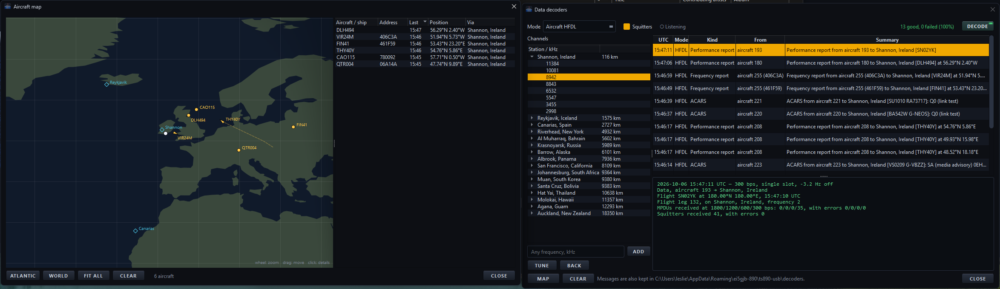

*HFDL from Shannon on 8942 kHz. On the right, reports from aircraft over
the Atlantic; on the left, the aircraft map with each one's position and
track, and the ground stations.*

| | |
|---|---|
| 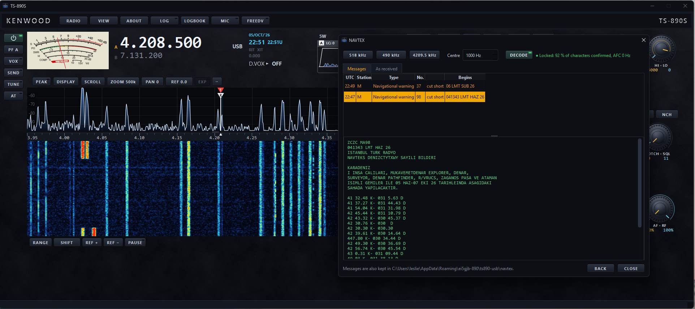 | 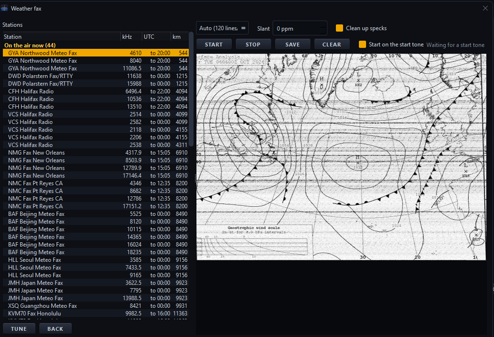 |
| **NAVTEX**: locked on at 4209.5 kHz, with each message listed by station, type and number, and shown in full. | **Weather fax**: a chart from Northwood, with the fax stations on the air now listed nearest first. Lines per minute are found by themselves, and a chart that ends is saved by itself. |

The window warns you only about what stops decoding: the radio not in
USB, a receive filter that cuts off the signal, or NR4 feeding the
decoders. Every message is also kept in a file.

## Remote operation (experimental)

Use your radio from somewhere else: a laptop in another room, or one at the
other end of the country. You get the same front panel, bandscope, meters
and audio as at home, and you talk through the laptop's microphone or
headset. Set **Connect over** in Connections to **Network**, and the radio's
own network port carries everything instead of the USB cable.

From outside your home, two more things are needed:

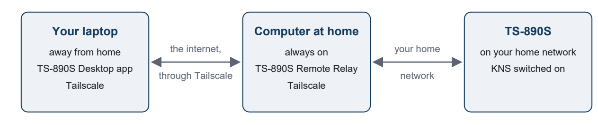

- **[Tailscale](https://tailscale.com)**, free, on the laptop and on a
  computer at home. It joins them over the internet as if they were on the
  same network, encrypted, with nothing opened on your home router.
- **The TS-890S Remote Relay**, a small program that comes with the app, on
  that computer at home. The radio only sends its audio to a computer on its
  own network, so the relay receives it there and passes it on to the
  laptop, with the laptop's transmit audio going the other way. Without it,
  control works from outside but there's no sound.

The relay lets the radio check your KNS login itself, serves one laptop at a
time, and frees the radio when you disconnect. It keeps the transmitter
safe:

- **If the laptop goes quiet for four seconds** while you're transmitting
  (a dropped mobile signal, a closed lid), the relay sends the radio to
  receive. It doesn't wait for the connection to time out.
- **No transmission lasts longer than ten minutes**, in case a key is
  stuck down at the far end. You can change the limit.

**On a phone or hotspot**, tick **Low data** on the Network page: the relay
sends compressed audio and a slower bandscope, about 50 MB an hour instead
of about 250. **The status bar** shows how good the link is, good, fair or
poor, with the ping, jitter and lost audio, so a choppy link can be told
from a quiet band.

> **Update the relay at home too.** The safety checks, low data and the
> ping need the relay from version 2.4. On a PC it comes with the app; on a
> Raspberry Pi, see [below](#raspberry-pi-for-the-remote-relay).

The computer at home can be the shack PC, where the installer can start the
relay with Windows, or a **Raspberry Pi**, which uses a few watts and starts
the relay by itself at every boot. The user guide's chapter on remote
operation goes through it all step by step, including the delays to expect
and how to keep it safe. Try it into a dummy load first.

## Fits your screen

The app is arranged on a big monitor. On a laptop, especially a 13 or
14-inch one where Windows also enlarges everything by 125, 150 % or more, it
wouldn't fit. So it fits itself, and usually you don't have to do anything:

- **The main window**: on a new install it measures the screen and, if
  needed, draws itself smaller and restarts once. After that it asks **Fit
  to this screen?** whenever the panel doesn't fit, when it starts or as
  soon as you change Windows' scaling or move to a smaller monitor. Tick
  **Don't ask again for this screen** to stop it asking.
- **Every other window** (the logbook, the PSK map, Remote receivers, the DX
  cluster, the About box and the rest) opens smaller to fit, or with scroll
  bars if what's inside can't shrink that far. Nothing is hidden or cut off.
- **Windows always stay on the screen**, title bar and all.
- **Choose the size yourself** any time under **VIEW → Display size**.

## The top of the screen

Across the top of the panel are the readouts the radio has across the top
of its own screen. Each one is a group of its own, so you can move it,
resize it or hide it, like any other part of the panel.

### The frequency display

The frequency display shows what the radio shows around its own frequency
readout, laid out the same way.

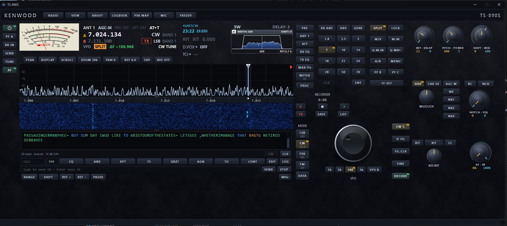

*CW with SPLIT on. Along the top: ANT 1, AGC-M, PRE OFF, ATT OFF and AT▸T,
the antenna tuner in line. VFO A is on 7.024.134 in CW and VFO B on
7.131.100 in LSB, with the TX box beside B, the VFO you transmit on. Along
the bottom: VFO, SPLIT and the offset between the two, and CW TUNE
flashing while the radio's CW auto-tune works.*

| Part | What it shows |
|---|---|
| **Top line** | ANT, AGC, PRE and ATT all the time, greyed when off. After them, only while they're on: the antenna tuner, RX ANT, NR, NB1, NB2, NOTCH, BC, PROC, RX EQ, TX EQ and MAX-Po. |
| **The antenna tuner** | **AT▸T** when the radio's tuner is in line for transmitting, and **R◂AT▸T** when it's in line for receiving too, as the radio shows it. It flashes while the tuner is tuning. |
| **VFO A and VFO B** | Each frequency with its mode and band memory, such as *CW BAND 1*. A **TX** box marks the VFO you transmit on, filled in red while you transmit. |
| **Bottom line** | VFO, or the memory channel; SPLIT and the offset between the VFOs (ΔF); and TF-SET, RIT, XIT and LOCK while they're on. |
| **CW TUNE** | Flashes on the right of the bottom line while the radio's CW auto-tune (the **CW T.** key) is working. |

**FINE**, beside the tuning knob, tunes in **1 Hz** steps. It's the radio's
own FINE, so press it here or on the radio and both follow.

### The S-meter

The S-meter looks and moves like the analogue meter on the radio. While you
receive, the needle points at the same S-unit the radio does. It rises
quickly and falls back slowly, like a real meter. While you transmit, it
shows the meter you have chosen with the **METER** key.

**Double-click** the meter to change how it looks. The app remembers your
choice.

| Dark face | Light face | Digital meter |
|:---:|:---:|:---:|
| 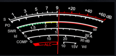 | 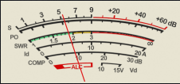 | 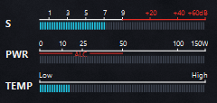 |
| White scales on black. | Black scales on cream, like the radio's white meter. | Bars for S, PWR and the meter chosen with METER, here TEMP. |

- **On the analogue faces**, the top scale is S1 to S9, then +20, +40 and
  +60 dB in red. The scales below it are for transmitting: PO (power), SWR,
  Id (current), COMP, ALC and Vd (voltage).
- **On the digital meter**, each bar fills from the left. S is the signal
  you are receiving. PWR is your power while you transmit, 0 to 150 W. The
  third bar is the meter chosen with METER.

### The METER key

**METER** chooses which meter shows while you transmit. Each press goes to
the next one: PO, ALC, SWR, COMP, Id, Vd, then TEMP. The one chosen shows
on the key.

- **COMP** is only offered while the speech processor (PROC) is on, as on
  the radio.
- **TEMP** is the radio's temperature. It puts the meter on its digital
  look, with a TEMP bar from Low to High.
- METER here and METER on the radio are the same setting. Press either and
  the other follows.

### The filter scope

The small scope at the top right is a copy of the filter scope on the
radio. It shows which receive filter is in use (A, B or C), its settings
(low cut, bandwidth and high cut, or width and shift), the filter's shape,
the audio inside it, and the roofing filter. For voice it has a 3 kHz
scale, and a 5 kHz scale once the high cut goes above 3 kHz, as the radio
does.

### The clock

The clock shows the radio's own date and time, and its second clock (UTC,
for example). **Double-click** it to open the **Radio clock** window, where
you can:

- set the radio to this computer's time with one click, or type a time in;
- have the radio set itself from a time server (NTP);
- choose the time zones, the date format, and which clocks the radio shows
  on its own screen.

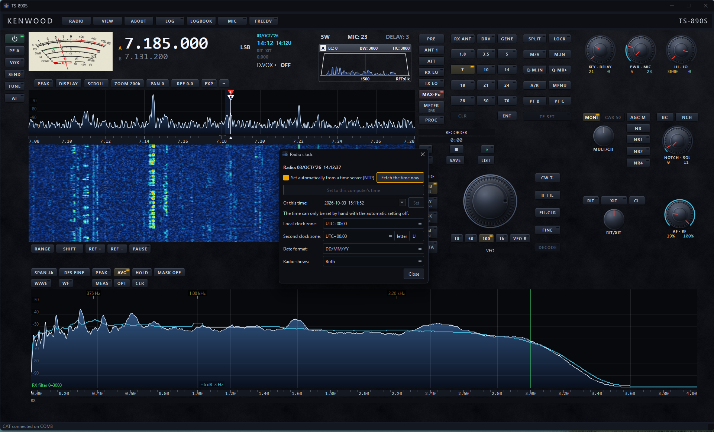

*The Radio clock window. Here the radio is setting its own time from a time
server, so setting it by hand is greyed out.*

### The other readouts

| Readout | What it shows |
|---|---|
| **RIT / XIT** | Whether RIT and XIT are on, and the offset: 0.000 when there is none. |
| **D.VOX** | Whether DATA VOX is on, and which input it listens to. |
| **Power / MIC / DELAY** | Your transmit power, microphone gain and delay, for example "5W MIC: 23 DELAY: 3". |
| **TCI** | Which programs are connected to the TCI server, as short tags: **L4OM** for Log4OM, **WSJT** for WSJT-X, **N1MM**, **JTDX**, and so on. If there are more than fit, it shows "+2" and so on. Rest the pointer on it for the full list. |

## Talk through the computer

Plug a headset or desk microphone into the PC, and talk on the air through
the app.

1. Open **RADIO → Connections**. On the **Microphone** page, tick **Mic
   in** and pick your microphone.
2. Talk, and watch **Level**. Aim for peaks around −12 dB. Use **Trim** if
   it doesn't get there.
3. Hold **MIC** on the top bar, or hold **F12**, and talk. Let go to go
   back to receive.

Tick **MIC key latches** if you'd rather click once to talk and again to
stop. The app adds no processing of its own. Shape your sound with the
radio's TX EQ, or with [plugins](#vst-3-plugins), and check it on the audio
scope. For safety, the microphone never transmits for more than three
minutes at a time.

## FreeDV digital voice

FreeDV is built in. Press **FREEDV** and the FreeDV pane opens under the
waterfall. **RADIO → Set up for FreeDV** puts the radio in USB-D (or
LSB-D, where stations work LSB) with the right filters, in one press you
can undo. When a station comes on you hear their voice without the hiss,
and their callsign shows in the pane. Hold **MIC** or **F12** to answer.
Your voice goes out as FreeDV, with your callsign.

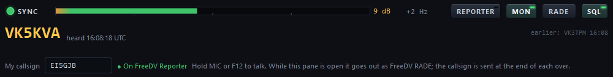

*The FreeDV pane in RADE: locked on to a signal 9 dB above the noise, with
the callsign of the station being heard.*

- **All the current modes.** RADE, which is what most FreeDV stations use
  now, and 700D, 700E and 1600. It works with the FreeDV application and
  anyone else running FreeDV.
- **FreeDV Reporter.** The **REPORTER** key shows every FreeDV station on
  the air, where they are, who is transmitting and who has heard whom.
  Double-click one to tune to it. You can put your own station on the list
  too, but only if you tick the box. Until then nothing about you is sent.
- **No extra setup.** It uses the same audio as the rest of the app. If
  your microphone works, FreeDV works.

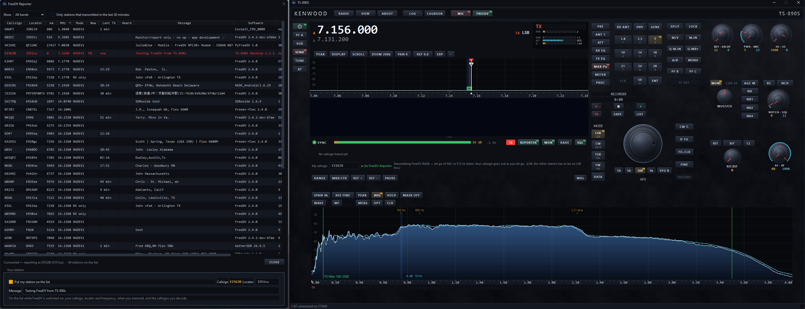

*FreeDV Reporter beside the front panel. EI5GJB is on the list and
transmitting in RADE on 7.156 MHz, so its line is red.*

## VST 3 plugins

Run the same equalisers, compressors, de-essers and noise reducers a
recording studio uses. There are two chains, each with its own window:

- **Microphone**: your voice, before it goes to the radio (and before
  FreeDV, when FreeDV is on).
- **Listen**: the radio's audio you hear on this computer, and FreeDV's
  decoded voice. The decoders, the audio scope, recordings and TCI still
  get the radio's audio as it arrives.

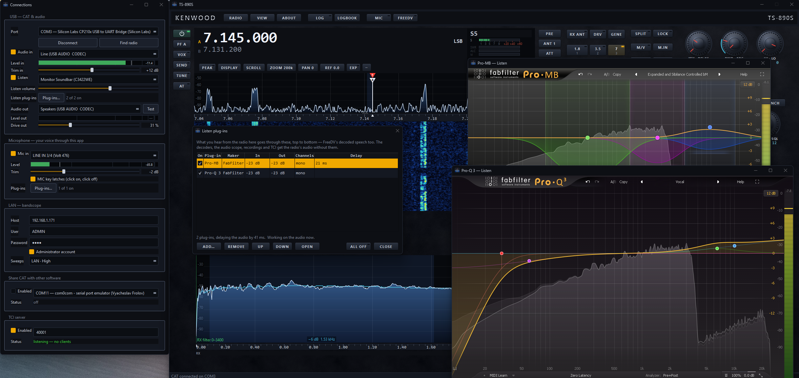

*Two Listen plugins working on the receive audio, with their own windows
open. In Connections, on the left, each chain says how many plugins it has
and how many are on.*

Open a chain with the **Plugins…** button in **RADIO → Connections**, or
from the RADIO menu. **ADD…** lists every VST 3 plugin on your computer.
Each plugin can be switched on and off, moved up or down, and opened to set
it up. **ALL OFF** lets you hear the difference they make. Every setting is
kept for next time.

| | |
|---|---|
| 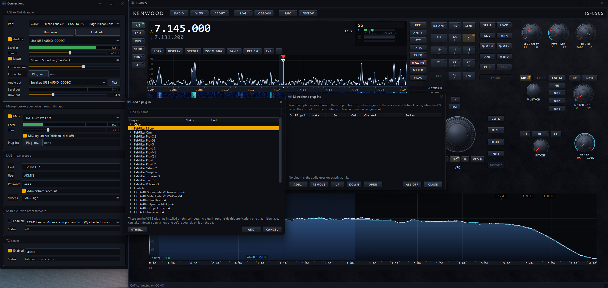 | 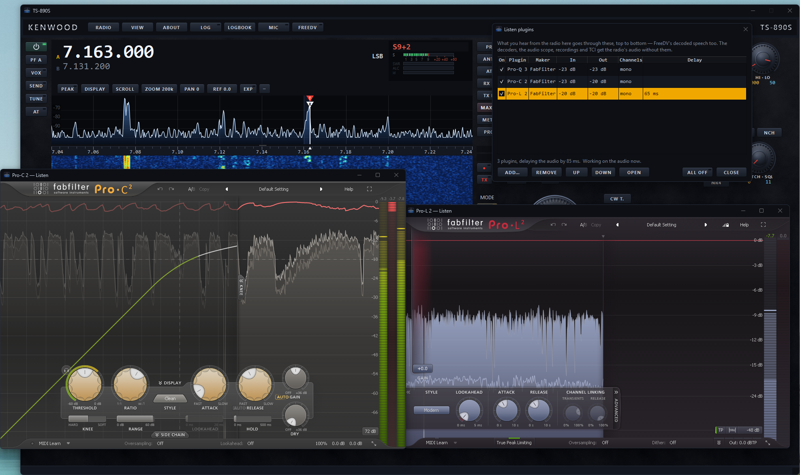 |
| Adding a plugin to the microphone chain. | A Listen chain of three plugins, with the level in and out of each, and how much they delay the audio. |

The plugins run in a separate program in the background. A plugin that
crashes or stops responding can't take the front panel with it, or leave
the radio stuck in transmit. Your audio carries on without it, and the app
tells you which plugin it was. Plugins have been tried on Windows so far.

## CW, RTTY and PSK31

The app decodes all three and sends all three, in a pane under the
waterfall. Press **DECODE** beside the tuning knob to open it.

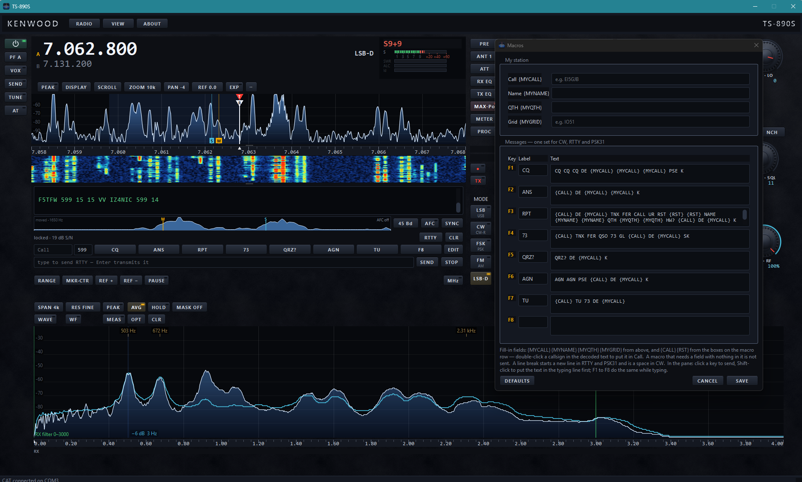

*RTTY on 40 m in LSB-D, locked on at 19 dB S/N. Under the copy are the
tuning indicator, 45 Bd, AFC and SYNC, the Call and RST boxes, the macro
keys and the typing line. On the right, EDIT has opened your station
details and the eight messages.*

- **Tuning RTTY**: the mark and space tones are marked on the bandscope.
  Drag them onto a station, or let **AFC** find it, and **SYNC** brings the
  radio onto it.
- **F1 to F8 macros**, with your call, name, QTH and locator, and the
  station you're working, filled in for you. A macro that needs a field
  that's empty isn't sent.
- **Take details from the copy.** Double-click a callsign in the decoded
  text and a menu asks what it is. Pick **Use as the DX callsign** and it
  goes into the Call box, ready for your macros. You can also pick their
  **report, name, QTH or locator**, and it goes into the QSO you are
  logging.

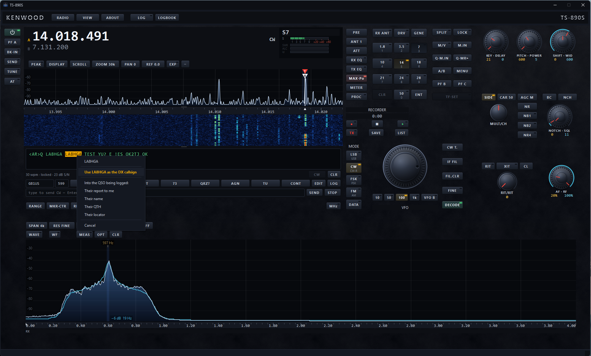

*CW on 20m at 30 wpm. LA8HGA has been double-clicked and the menu is
offering to make it the DX callsign. Under the text are the Call and RST
boxes, the F1 to F8 macro keys, EDIT and LOG.*

Then press **LOG** beside the macros, or Ctrl+L: the QSO opens with their
call, your report and their signal already in. Press it again to save.

### Reading CW

The CW decoder was rebuilt for 2.4.4 to copy the way a CW skimmer does.
The copy appears about one character behind the sender. When there's only
noise, it prints nothing.

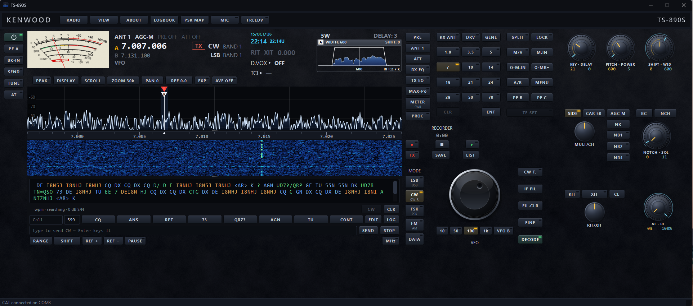

*CW on 40 m. CQ, DX, DE, TU and the other CW words are blue, and the
callsigns are orange. Words the decoder doesn't recognise stay green.*

- **Any speed, any fist.** It finds the speed by itself, from about 8 to
  45 wpm, and follows it as it changes, so hand-sent CW with uneven spacing
  copies as well as a keyer.
- **No need to tune exactly.** It finds the station's own tone, up to
  100 Hz either side of your CW pitch, and follows it if it drifts.
- **Whole words, put right.** Two words run together are split (*TUEC6AAE*
  becomes *TU EC6AAE*), and a callsign or word sent with a gap is joined
  (*EI5 GJB* becomes *EI5GJB*). So the last word may change a moment after
  it appears.
- **Real callsigns.** It checks calls against the Super Check Partial list
  of calls heard on the air, which the app downloads and keeps up to date
  by itself.

| Colour | What it means |
|---|---|
| **Red, bold** | A callsign on the Super Check Partial list. |
| **Orange** | Something shaped like a callsign that isn't on the list: a new call, or one misread. |
| **Blue** | A CW abbreviation, Q-code or report: CQ, DE, TU, QTH, 5NN… |
| **White** | A first name. |
| **Grey** | A letter the decoder is unsure of. Worth a second look. |
| **Green** | Everything else. |

**Who is on the frequency.** When the station you're listening to gives
its call (after DE, CQ, TEST or TU, or sent twice), the call is written on
the bandscope at that frequency for 15 minutes. As you tune across the
band, the bandscope fills in with who is where. A call that isn't on the
list is only labelled once it's been heard twice, so one misreading never
puts a wrong call there. **LABELS**, on the decode pane's status line,
turns the labels off and on.

**CW T.** starts the radio's own CW auto-tune, which puts the radio exactly
on the station. **CW TUNE** flashes on the frequency display while it works.

## Band plans

Choose your country under **RADIO → Band plan**: Ireland, the UK, the USA,
Canada or Australia, or the IARU's own plan for Region 1, 2 or 3. On every
HF band, coloured strips along the top of the bandscope show which part of
the band is for what: CW, data, phone, all modes, beacons and so on. Rest
the pointer on one for the details. If what you are about to transmit falls
outside your plan, or is too wide for that part of it, a short note
appears. It only tells you. It never stops you transmitting. The IARU plans
are recommendations rather than law, so for those the note is gentler.

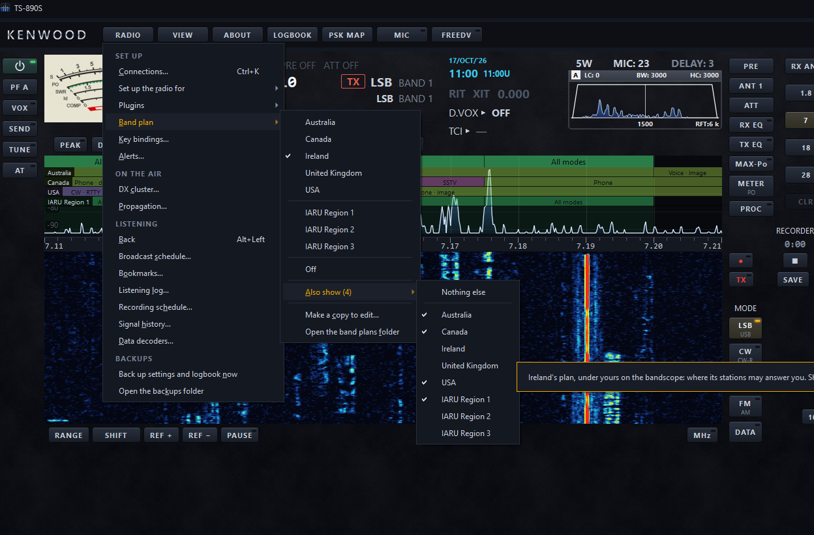

*RADIO → Band plan, with four more plans ticked under Also show. The menus
stay open while you tick, so you can choose several in one go.*

- **See other countries' plans as well.** Under **Also show**, tick up to
  four more. Each is a thinner strip under yours, with its name at the
  left. Working DX, you can see where the other station may answer you.
- **Make your own.** **Make a copy to edit…** copies the plan in use to
  your band plans folder as a simple text file. Edit it, save it, and the
  bandscope updates by itself.
- On 5 MHz the radio's transmit and receive filters are set to the band's
  width (2.7 kHz in Ireland and the UK, 2.8 kHz in the US). Your own
  filters are put back when you leave the band.

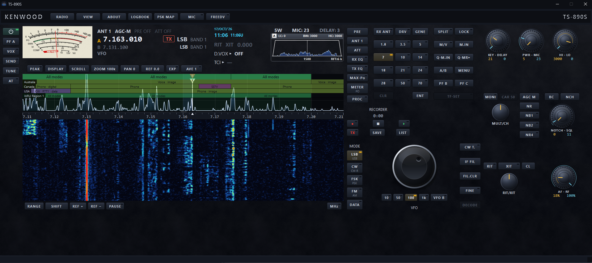

*40 m with Ireland's plan along the top and Australia, Canada, the USA and
IARU Region 1 under it. Where Ireland allows all modes, the USA keeps CW,
RTTY and data low in the band and phone high.*

## Log4OM over TCI

Log4OM can follow the radio through the app's TCI server. In Log4OM, open
the configuration, go to **Hardware Configuration → CAT interface**, and
set **CAT Engine** to **TCIProtocol**. On the **TCI** tab, set the address
to **localhost** and the port to the one shown in the app's Connections
window (40001 here).

| | |
|---|---|
| 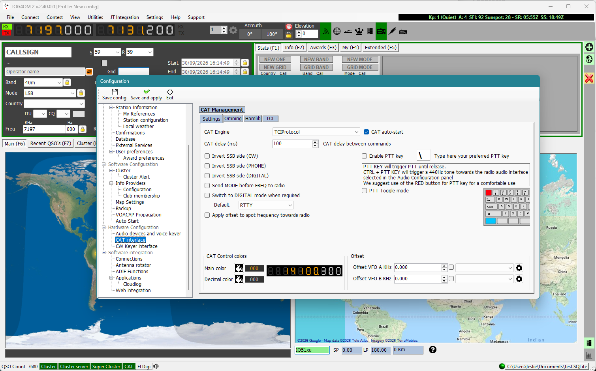 | 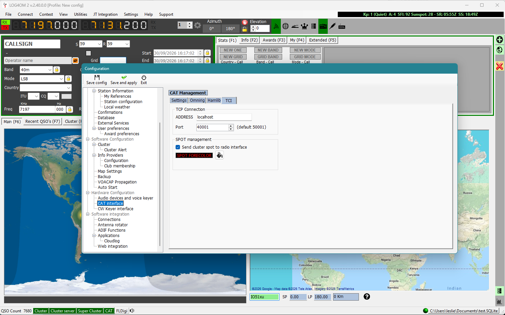 |
| CAT Engine set to TCIProtocol. | The TCI tab: localhost and the app's port. |

> **Log4OM doesn't reconnect by itself.** If you close and restart the
> app, start Log4OM's CAT again with **Connect → CAT → Start CAT**. Other
> programs, such as WSJT-X, reconnect on their own.

## Download and install

### Windows

1. Go to the
   [latest release](https://github.com/lmacc/Kenwood-TS-890-Client-TCI-Server-v2/releases/latest)
   and download **`TS-890S-Desktop-<version>-setup.exe`**.
2. Run it. It installs just for you and doesn't need an administrator. On
   its first page you can choose to install it for everyone on the computer
   instead.
3. Start **TS-890S Desktop** from the Start menu. The user guide is there
   too.

> **"Windows protected your PC"?** The installer isn't digitally signed
> yet, so Windows asks before running it the first time. Click **More
> info**, then **Run anyway**.

The first time you run it, the Connections window opens and the app looks
for the radio's COM port by itself. Then, on the **Network** page, set the
radio's IP address for the bandscope, and on the **Audio** page tick
**Audio in**.

On the installer's tasks page there's also a tick box to **start the TS-890S
Remote Relay with Windows**. Only tick it on the computer at the radio, and
only if you'll operate from outside your home. It's off by default.

> **No frequency showing?** The radio has two COM ports and only one of
> them works for control. Press **Find radio** in **RADIO → Connections**
> and the app picks the right one. It also tells you if another program is
> using the port, or if the radio's CAT speed (menu 7-00) isn't 115200.

**Updating:** run the new version's installer. It removes the version you
have first, so there's only ever one copy on the computer, and your
settings, layouts and logbook are kept. Updates only go forward: an older
version won't install over a newer one. From 2.4.4 the installer is the
only Windows download; there's no portable zip.

The app checks once a day for a newer version. When there is one, the lamp
on **ABOUT** lights and the About box has a **DOWNLOAD** key. Only the
app's name and version are sent to GitHub to ask. The same part of the
About box keeps the CW decoder's callsign list up to date.

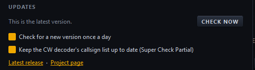

To remove the app, use **Settings → Apps** like any other program.

### Mac

The Mac version is built and checked the same way as the Windows version,
but it hasn't been tried on many Macs yet. If you use it, please let me
know how it goes, good or bad, in
[Issues](https://github.com/lmacc/Kenwood-TS-890-Client-TCI-Server-v2/issues).

1. Go to the
   [latest release](https://github.com/lmacc/Kenwood-TS-890-Client-TCI-Server-v2/releases/latest)
   and download **`TS-890S-Desktop-<version>-macos.dmg`**.
2. Open it and drag **TS-890S Desktop** into the **Applications** folder.
3. Open it from Applications.

> **"Apple could not verify…"?** The app isn't signed by Apple yet, so the
> Mac asks before opening it the first time.
> On **macOS 15 or later**: try to open it once and click **Done**. Then go
> to **System Settings → Privacy & Security**, scroll down and click **Open
> Anyway**.
> On **macOS 13 or 14**: hold Control and click the app in Applications,
> choose **Open**, then **Open** again.
> You only have to do this once.

The Mac will then ask if the app can use the **microphone**. Say yes. That's
how it hears the radio's USB audio. Without it the scopes and decoders get
no sound. It may also ask about the **local network**. That's for the
bandscope, so say yes to that too.

The first time you run it, the Connections window opens and the app looks
for the radio's port by itself. The radio's USB ports show up with names
like `cu.SLAB_USBtoUART` or `cu.usbserial-…`. If it picks the wrong one,
press **Find radio**. To update later, drag the new version over the old
one. Your settings are kept.

The radio's network login, like your QRZ.com and LoTW logins, is kept in
your Keychain. After installing a new version, macOS may ask once whether
TS-890S Desktop can use it. Choose **Always Allow**.

### Raspberry Pi, for the Remote Relay

Only needed for [remote operation](#remote-operation-experimental), if you'd
rather leave a Raspberry Pi on at home than a PC. It runs the relay, not the
app.

1. From the
   [latest release](https://github.com/lmacc/Kenwood-TS-890-Client-TCI-Server-v2/releases/latest),
   download **`TS-890S-Remote-Relay-raspberry-pi.tar.gz`** and copy it to
   the Pi.
2. On the Pi, using your radio's address in the last line:
   ```
   tar xzf TS-890S-Remote-Relay-raspberry-pi.tar.gz
   cd ts890-remote-relay
   sudo sh install.sh 192.168.1.171
   ```
3. It starts at once, and at every boot. The last lines show the Pi's
   Tailscale address, which goes in **Host** on the laptop.


*The relay installed and running on a Raspberry Pi. The last line is the
Pi's Tailscale address, for Host on the laptop.*

**To update it**, copy the new package to the Pi and run the same three
lines. The installer replaces the relay and restarts it. If you changed the
transmit limit, set it again afterwards.

Needs a Raspberry Pi 2 or later (including the Pi Zero 2 W) with Raspberry
Pi OS, 32-bit or 64-bit, and Tailscale. The README in the package and the
user guide have the commands for stopping, starting and reading its log.

### What it runs on

| | Windows | Mac |
|---|---|---|
| **System** | Windows 10 or 11, 64-bit | macOS 13 Ventura or later (13, 14 Sonoma, 15 Sequoia, 26 Tahoe) |
| **Computer** | Any 64-bit PC | Apple silicon Macs (M1, M2, M3, M4 and newer) and Intel Macs. One download works on both. |
| **Download** | `…-setup.exe` | `…-macos.dmg` |
| **Won't run on** | Windows 7 or 8, or 32-bit Windows | macOS 12 or older. That includes older Intel Macs that can't update past macOS 12. |

You also need:

- The USB cable from the radio to the computer, and the radio's USB driver
  (Silicon Labs CP210x) so its ports show up. On a Mac, if the ports don't
  appear, install the CP210x driver for macOS from Silicon Labs.
- The radio's CAT speed set to **115200** (menu 7-00).
- For the bandscope over the network: the radio on your network, and the
  KNS user name and password set on the radio. Everything else works
  without it, just with a slower bandscope over USB.
- For remote operation: no USB cable on the laptop. The radio on your home
  network with its KNS and built-in VoIP switched on and, from outside your
  home, Tailscale and the Remote Relay. See
  [Remote operation](#remote-operation-experimental).
- For QRZ.com, Logbook of the World, PSK Reporter, the DX cluster and
  propagation: an internet connection. Each is used only when you open it
  or switch it on, and nothing about your radio is sent.

On a Mac there's no CAT sharing. Use the TCI server to connect other
programs instead. The logbook works with Mac loggers that take QSOs from
WSJT-X, such as MacLoggerDX and RUMlogNG.

## The user guide

The download comes with a full user guide, written for someone who has
never used the app before. You can open it any time from **ABOUT → USER
GUIDE**. It has a contents page, bookmarks in your PDF reader's side panel,
and an index at the back, so you can go straight to what you need. It
covers every window and key, with a picture of each:

- **Setup in one window.** COM port, audio, microphone, bandscope and
  sharing, with **Find radio** to pick the right COM port.
- **The panel**: the top of the screen, tuning, band stacks, split and
  TF-SET, the bandscope and the audio scope, NR4, and making the layout
  yours.
- **CW, RTTY, PSK31, FT8, the microphone, FreeDV and plugins**, with
  reading CW, its colours and callsign labels, and calls to watch for.
- **Logging**: the Log QSO window, the Logbook with its statistics, map and
  awards, finding duplicates, and linking it to your logger both ways.
- **Contests**: the exchange, serial numbers, dupes, the running tally,
  Cabrillo and the calendar.
- **QSL services, the PSK map, the DX cluster with the Reverse Beacon
  Network, and propagation.**
- **Listening**: the broadcast schedule, bookmarks and scanning, the
  listening log, signal history and recording at set times.
- **The data decoders**: DSC, ALE, HFDL and the aircraft map, SELCAL,
  PACTOR, NAVTEX and weather fax.
- **Remote operation**, step by step on a PC or a Raspberry Pi, with
  updating the relay, low data, the link readout and keeping it safe.
- **The radio's menu**, **keyboard shortcuts**, where your settings live,
  **backups and restoring one**, **keeping up to date**, **transmit
  safety**, and a **troubleshooting** table that goes from the problem to
  the most likely cause.

## Support

If it's earned a place in your shack, a coffee keeps it going. There's a
**DONATE** key in the app's About box, or use the button below.


[](https://www.paypal.com/donate/?business=9XVP453VRC5GC&no_recurring=0&item_name=Free%2C+and+always+will+be.+If+it%27s+earned+a+place+in+your+shack%2C+a+coffee+keeps+it+growing.+73%2C+Leslie+EI5GJB&currency_code=EUR)

73, Leslie EI5GJB

## Licence

Free to use, on as many computers as you like, and free to pass on as long
as you pass on the installer unchanged, but it's not for sale. Licence keys
are personal to the donor. The
full terms are in `LICENSE.txt` in the download. Only the finished program
is released, not the source code.

It uses Qt, libspecbleach, codec2, RADE, Opus, the VST 3 SDK and KISS FFT,
which each have their own licence. You'll find those in the `licenses`
folder of the download. The source of libspecbleach and codec2, as used, is
attached to each release.

Map data from Natural Earth. Broadcast schedules from EiBi. Spots from
Spothole, the DX cluster network and the Reverse Beacon Network. Callsigns
for the CW decoder from Super Check Partial (supercheckpartial.com). Reports from PSK Reporter. Space
weather from NOAA and HAMQSL.com (N0NBH), ionosondes from GIRO and NOAA by
way of KC2G, and the weather model from Open-Meteo.

VST is a registered trademark of Steinberg Media Technologies GmbH. This
app is not made or endorsed by JVCKENWOOD. TS-890S and KENWOOD are
trademarks of JVCKENWOOD Corporation.
